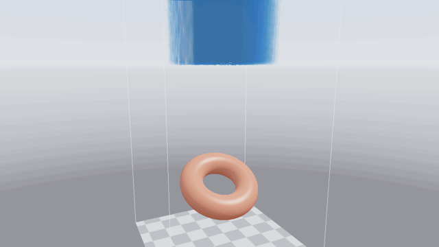

# Fluid
## SPH fluid simulation in Rust and WebGPU


This is a demo of a particle-based fluid simulation using the SPH method. All the rendering and computing is done on the GPU through the wgpu crate. Neighbours are found with a uniform grid: each step the particles are sorted by cell with a GPU counting sort, so each particle only checks the 27 cells around it.

The fluid collides with triangle meshes loaded from OBJ files, which are baked into signed distance fields. It is drawn with screen-space fluid rendering: smoothed depth, thickness, refraction, absorption, Fresnel reflections and specular highlights.

## Running

```
cargo run --release
cargo run --release -- path/to/mesh.obj
```

Without an argument the scene uses `assets/torus.obj`. Collider meshes should be watertight, and their transforms may only use uniform scale.

## Demo



64,000 particles falling onto a torus, shown with water shading and then with spheres coloured by speed. The footage was rendered offline at half speed, so it runs faster than the live simulation does. [Full-quality video](assets/demo.mp4) (1920x1080, 60 fps).

## Controls

- To move around the simulation use the [**W A S D Space LShift**] keys
- To look around hold the left mouse button and drag
- To stop/start the simulation at any point use the **C** key
- To restart the simulation use the **R** key
- To switch between the shaded fluid and spheres coloured by speed use the **T** key
- To zoom in/out use the scroll wheel on your mouse

## References

- [Paper](https://github.com/genpfault/sph-tutorial/blob/master/papers/Efficient%20Neighbor%20Search%20for%20Particle-based%20Fluids.pdf) - Efficient Neighbor Search for Particle-based Fluids
- [Paper](https://matthias-research.github.io/pages/publications/sca03.pdf) - Particle-Based Fluid Simulation for Interactive Applications
- [Paper](https://developer.download.nvidia.com/presentations/2010/gdc/Direct3D_Effects.pdf) - Screen Space Fluid Rendering for Games
- [Guide](https://sotrh.github.io/learn-wgpu/) - Learn wgpu

## License

MIT
